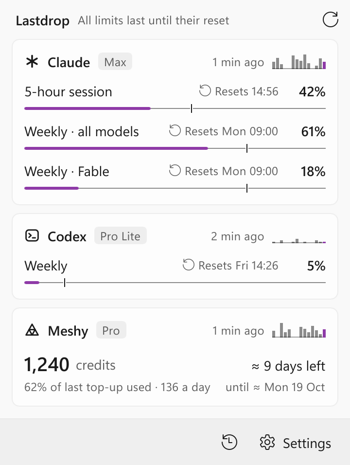
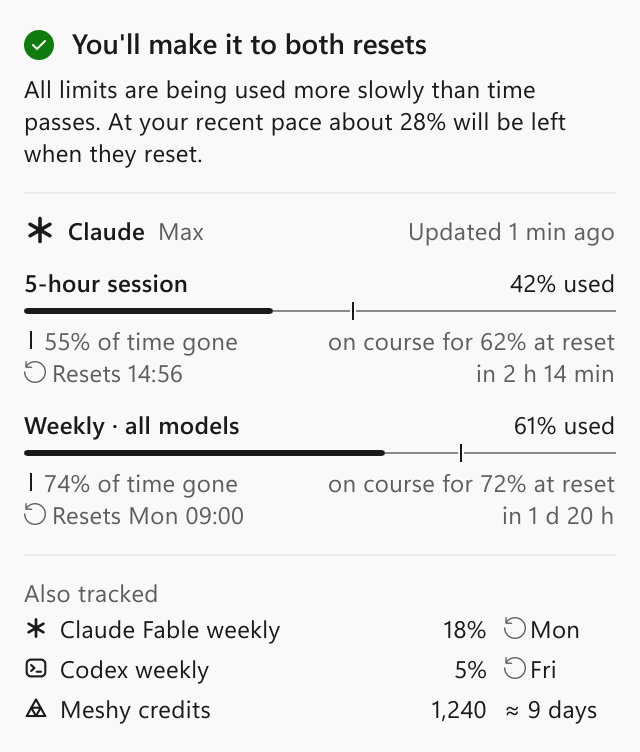
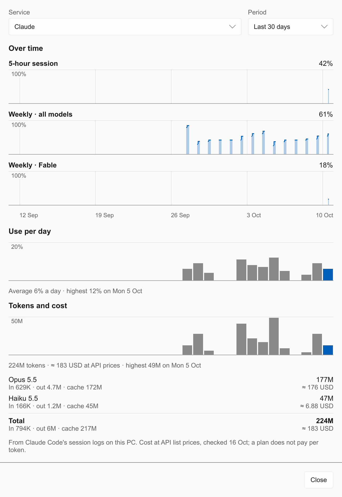

# Lastdrop

How much AI is left in the tank, one click away.

Lastdrop is a Windows 11 tray app that shows your remaining usage across AI services —
Claude, Codex, GitHub Copilot, Meshy and more — without opening each service's usage page. Click the tray
icon and you see what is left, when it resets, what you used recently, and whether your
current pace will last until the next reset.

  <picture>
    <source media="(prefers-color-scheme: dark)" srcset="docs/assets/screenshots/flyout-dark.png">
    
  </picture>

## Goals

- **One glance.** A native Windows 11 flyout next to the volume and network flyouts.
- **Light on memory.** It runs all day, so it should cost next to nothing while hidden.
- **Your choice of what to show.** Pick the services, the meters and the widgets you care about.
- **Real statistics.** History, burn rate, pace and a forecast of when you run out.
- **Easy to extend.** Simple balance endpoints are described in a JSON file; no compiler needed.
- **Your data stays yours.** Everything is read and stored locally. Nothing is sent anywhere
  except to the service whose usage is being read.

## Status

Early version: [v0.1.0](https://github.com/2Fivers/lastdrop/releases/latest) is the first public
release. Built in Rust with Slint's software renderer, the stack the spike picked by measuring
idle memory and flyout latency ([ADR 0001](docs/adr/0001-rust-and-slint-software-renderer.md)).

The first useful build is done: tray icon, taskbar readout, flyout, hover card, settings and
autostart, reading Claude, Codex, GitHub Copilot, Cursor, Google Antigravity, OpenCode Go, Grok and
Meshy, with notifications when a limit
reaches 80 % or 95 %, is used up or resets. It speaks English and Swedish, following Windows'
display language unless one is picked in settings. Claude Code and Codex can have several
accounts, one per config folder. Services with a simple balance or usage API are described in a
JSON file (DeepSeek, ElevenLabs and OpenRouter come with it). A usage history window charts each
limit over the last 7, 30 or 90 days, the use per day and the hours of the week with the most use.

## Screenshots

Hover over the taskbar readout or the tray icon and a card explains the numbers: how much of each
window has gone, where your pace ends up at the reset, and what else is tracked.

  <picture>
    <source media="(prefers-color-scheme: dark)" srcset="docs/assets/screenshots/hovercard-dark.png">
    
  </picture>

The usage history window charts each limit over time and the use per day. For Claude and Codex it
also counts the tokens from the session logs on your PC and what they would cost at API prices.

  <picture>
    <source media="(prefers-color-scheme: dark)" srcset="docs/assets/screenshots/history-dark.png">
    
  </picture>

The screenshots show the app's built-in demo data, not a real account.

## Install

- **winget:** `winget install lastdrop` (the package is `2Fivers.Lastdrop`; it is on its way
  into winget).
- **By hand:** download `Lastdrop-Setup.exe` from the
  [latest release](https://github.com/2Fivers/lastdrop/releases/latest) and run it. It installs
  for the current Windows user, no administrator rights needed, and updates itself from the same
  releases. Uninstall it from Settings ▸ Apps ▸ Installed apps.

The installer is not code-signed yet, so Windows SmartScreen warns the first time: choose
*More info ▸ Run anyway*. To check that GitHub built it from this repository:
`gh attestation verify Lastdrop-Setup.exe --repo 2Fivers/lastdrop`.

## Plan

See [docs/ROADMAP.md](docs/ROADMAP.md) for providers, features, milestones and what is built,
and [docs/ARCHITECTURE.md](docs/ARCHITECTURE.md) for how the app is put together.

## Contributing

Issues and pull requests are welcome; read [CONTRIBUTING.md](CONTRIBUTING.md) first. Report
security problems privately as described in [SECURITY.md](SECURITY.md), not in an issue.

## Support Lastdrop

Lastdrop is free. If it saves you a few clicks a day, you can support its development through
[GitHub Sponsors](https://github.com/sponsors/2Fivers) or
[Buy Me a Coffee](https://buymeacoffee.com/2fivers).

## Disclaimer

Lastdrop is an independent project and is not affiliated with, endorsed by or sponsored by
Anthropic, OpenAI, GitHub, Cursor, Google, xAI or any other service it reads. Product names are
the trademarks of their owners and are used only to say which service a reading comes from.

## License

Copyright © 2026 2Fivers. Licensed under either of

- Apache License, Version 2.0 ([LICENSE-APACHE](LICENSE-APACHE))
- MIT license ([LICENSE-MIT](LICENSE-MIT))

at your option.

Unless you explicitly state otherwise, any contribution intentionally submitted for inclusion
in Lastdrop by you, as defined in the Apache-2.0 license, shall be dual licensed as above,
without any additional terms or conditions.

Lastdrop's user interface is built with [Slint](https://slint.dev), used under the Slint
Royalty-free License 2.0. A build you distribute, a fork included, must keep the About window's
`AboutSlint` widget ([ARCHITECTURE](docs/ARCHITECTURE.md), "Slint licence rule").
