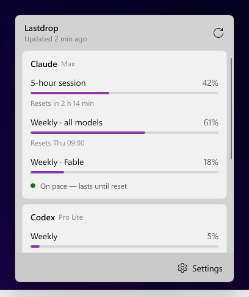
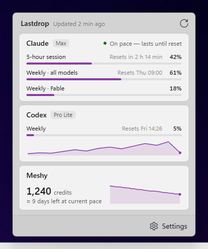

# 0001 — Rust with Slint's software renderer

- **Status:** Proposed (2026-10-10), awaiting the owner's go
- **Deciders:** pRob3

## Context

Lastdrop runs all day, so its memory while hidden matters more than almost anything else, and
a click on the tray icon has to open the flyout instantly. The flyout should look like a native
Windows 11 flyout. .NET + WinUI 3 was ruled out up front (about 120–160 MB idle in published
benchmarks). Two Rust options were left, so we built the same flyout in both and measured them
instead of guessing:

- **Rust + Slint**, the UI drawn by Rust (five renderers tried);
- **Rust + Tauri 2**, the UI as a web page in WebView2 (kept alive, kept alive in low-memory
  mode, or destroyed on hide).

Both spikes are kept in [`spikes/`](../../spikes) and the measuring scripts in
[`tools/measure/`](../../tools/measure), so the numbers can be reproduced and the real app can be
held to them.

## Measurements

2026-10-10, i9-14900KF, Windows 11 26200, 100 % scale, 3 runs × 50 s per variant, run one at a
time on an idle machine. Memory is the **private working set** (Task Manager's "Memory" column)
summed over the app and every child process; median of 3 runs.

| Variant | Hidden | Shown | Hidden again | Processes | Show (cold / warm) | Exe |
|---|---|---|---|---|---|---|
| **Slint, software renderer** | **3.0 MB** | **3.0 MB** | **3.0 MB** | 1 | 7 / 3 ms | 10.4 MB |
| Slint, Skia software | 8.4 MB | 8.4 MB | 8.4 MB | 1 | 4 / 3 ms | 18.2 MB |
| Slint, FemtoVG on wgpu (D3D12) | 68.5 MB | 68.6 MB | 71.3 MB | 1 | 13 / 7 ms | 14.5 MB |
| Slint, OpenGL renderers | 37 MB | — | — | 1 | content missing with the backdrop on this NVIDIA machine | |
| Tauri, kept alive | 68.5 MB | 78.2 MB | 79.5 MB | 7 | 43 / 16 ms | 3.2 MB |
| Tauri, kept alive, low-memory mode | 68.8 MB | 78.3 MB | 69.1 MB | 7 | 57 / 15 ms | 3.2 MB |
| Tauri, destroyed on hide | 1.4 MB | 79.5 MB | 3.5 MB | 1 / 7 | **408 / 383 ms** | 3.2 MB |

At rest every variant used no measurable CPU. Tauri's floor is WebView2's six helper
processes (browser, GPU, renderer, network, storage, crash handler); destroying them on hide
brings memory down but makes every click wait about 0.4 s and costs about 1.5 s of CPU.

Both looked close to native: the same DWM acrylic backdrop, rounded corners, Segoe UI Variable,
Fluent icons and the system accent. The layout differences in the screenshots are the two
spikes' own design choices, not the frameworks.

| Slint, software renderer | Tauri |
|---|---|
|  |  |

## Decision

Build Lastdrop in **Rust with Slint, using the software renderer only** (`SLINT_BACKEND`
fixed to the software renderer, the others not compiled in). About 3 MB while running,
whether the flyout is open or not, and it opens in a few milliseconds.

## Consequences

- **Licence:** Slint is used under its Royalty-free License 2.0, which allows a closed-source
  desktop app on one condition: an "About" screen reachable from the app shows the `AboutSlint`
  widget (or a public download page shows the "Made with Slint" badge). Lastdrop gets an About
  item in the tray menu. Third-party notices for all crates are generated at build time.
- **Static C runtime** (`+crt-static`), so the exe needs no Visual C++ redistributable.
- **No GPU renderer.** The OpenGL renderers drew nothing behind the acrylic backdrop on this
  NVIDIA machine, Skia on D3D12 is broken with transparency in Slint 1.18.1, and FemtoVG on
  D3D12 costs 65 MB. The software renderer is fast enough for a 360 × 440 flyout; animations
  must be kept small and measured.
- **The Windows integration is ours:** tray icon position, flyout placement, backdrop, hiding on
  focus loss and the taskbar readout are hand-written Win32 (about 350 lines in the spike). The
  taskbar readout is its own layered window with its own drawing, as the reference does it.
- **Memory is a tested property.** Each release is measured with `tools/measure` against a
  budget: under 10 MB private working set with flyout and readout, flat after hide.
- **Cross-platform later is possible** (Slint runs on macOS and Linux), but the Win32 parts would
  have to be written again for each platform.
